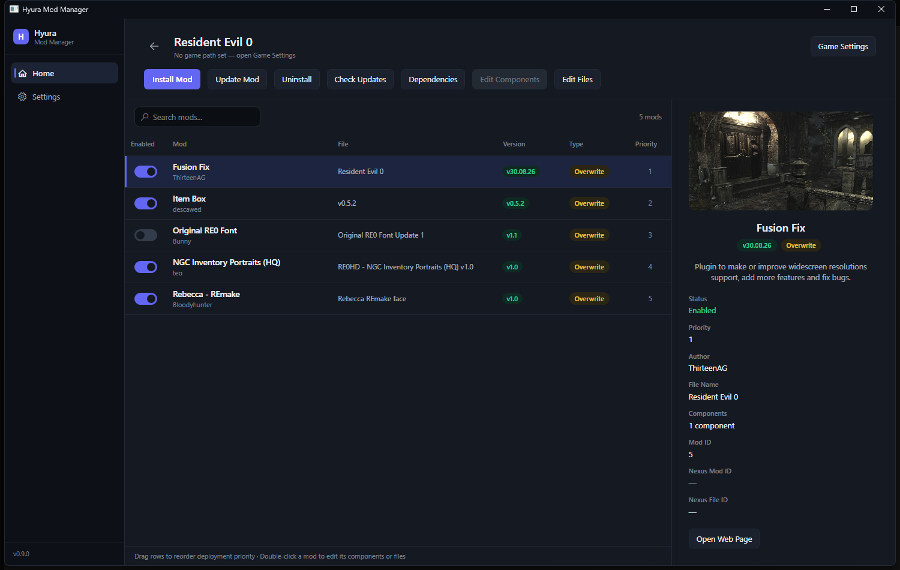

# Hyura Mod Manager (HMM)

A desktop mod manager for Windows that installs, deploys and organizes mods for games
built on **RE Engine**, **MT Framework** and **Unreal Engine**.

HMM keeps every mod in its own folder, deploys only what you enable, backs up the
original game files, and restores them when you disable or uninstall a mod. It
understands Fluffy `modinfo.ini` packages, REFramework plugins, Unreal `.pak` and
LogicMods files, loose Lua/DLL mods, plain overwrite mods, and Hyura packages.

  

> **Status: pre-release.** HMM is under active development. The first stable release
> will be `1.0.0`; until then, keep your backups and expect changes.

## Download

Builds are published on the
[Releases](https://github.com/TaylorHyura/Hyura-Mod-Manager/releases) page.

1. Download the latest release archive.
2. Extract it to a writable folder, such as `C:\Games\HMM`. Do not run it from inside
   the archive or from `Program Files`.
3. Run `HyuraModManager.exe`.

HMM keeps its settings, mods and backups beside the executable, so moving the folder
moves your setup. No installer is required.

If Windows SmartScreen shows a warning for a new build, confirm the download came from
this repository's Releases page before running it.

## Features

- **Game library** - Browse the official and community catalogs, add games, and keep
  covers cached for offline use.
- **Mod installation** - Install one or many `.zip`, `.rar`, `.7z` or `.pak` files.
  Each mod gets its own folder under `InstalledMods`.
- **Engine-aware detection** - Mods are classified as Fluffy, Plugin, Pak, LogicPak,
  Lua, Overwrite or Hyura, and their files are placed where that engine loads them.
- **Hyura packages** - Archives with a `hyuramod.json` manifest install the same way on
  any supported engine, with components that mirror the game's folder layout.
- **Deployment control** - Enable or disable a whole mod, an individual component, or a
  single file. Drag rows to decide which mod wins a file conflict.
- **Backups and restore** - Original game files are moved to `BackupFiles` the first time
  a mod overwrites them, and restored when the mod is disabled or removed.
- **Dependencies** - Per-game loaders such as REFramework or UE4SS, with one-click
  download and installation.
- **Updates and reinstall** - Check installed mods against Nexus and update from a new
  archive without losing the mod's position.
- **Themes and accessibility** - Light, Dark, Graphite Dark and Auto themes, keyboard
  focus styles, and accessible control names.

## Requirements

- Windows 10 or 11 (64-bit)
- A writable folder for the app and its data
- Optional: a Nexus Mods API key for metadata and update checks. Manual installation
  works without one.
- If a release note lists the .NET 10 Desktop Runtime as a requirement, install it
  before launching HMM.

## First run

1. Open **Settings**. Optionally paste a Nexus API key from
   <https://www.nexusmods.com/settings/api-keys>, and choose a theme.
2. On **Home**, switch to **Browse**, add the games you want, then switch back to
   **My Games**.
3. Open a game, choose **Game Settings**, and set the game's install directory.
4. If the game needs one, open **Dependencies** and install its loader, such as
   REFramework or UE4SS.
5. Choose **Install Mod** and select one or more mod archives. HMM extracts, classifies
   and deploys them.
6. Toggle mods on or off, drag rows to set priority, and double-click a mod to manage
   its components or individual files.

The game path is checked during deployment. If the folder does not contain the game
executable, HMM keeps the mod list but does not copy files into it.

## Supported games and engines

Games are data, not code. HMM reads the live catalog from
[HMM-Supported-Games](https://github.com/TaylorHyura/HMM-Supported-Games) and stores the
definition of each game you add under `SupportedGames\<game-id>.json`.

The catalog has two tiers:

- **Officially Supported** - curated and tested by the HMM maintainer.
- **Community Supported** - contributed by the community through pull requests.

Both tiers work in the app. New games can be added to the catalog without an HMM
update. If a game is missing, see the
[catalog contribution guide](https://github.com/TaylorHyura/HMM-Supported-Games/blob/main/CONTRIBUTING.md).

| Format / engine | What HMM understands |
| --- | --- |
| **Hyura (any engine)** | Packages with a `hyuramod.json` manifest whose component folders mirror the game's install layout. |
| **RE Engine** | REFramework plugin DLLs, Fluffy-style `modinfo.ini` packages (including addons), and PAK invalidation for `natives` files. |
| **MT Framework** | `nativePC`-style archives and overwrite mods. |
| **Unreal Engine** | `.pak` mods, LogicMods, loose Lua and DLL mods (UE4SS-style), and overwrite/loader mods. |

## Backups and safety

Before HMM overwrites a game file for the first time, it moves the original to
`BackupFiles\<game-id>` and records its SHA-256 hash. Disabling or uninstalling the mod
restores the backed-up file.

Keep `BackupFiles` until you are happy with your setup. If something goes wrong, disable
the mod in HMM first; manually deleting backups can make the original game files
impossible to restore.

## Data folders

Everything is relative to the folder containing `HyuraModManager.exe`:

| Path | Contents |
| --- | --- |
| `AppSettings.json` | Theme, Nexus API key, added game IDs, and per-game install paths |
| `SupportedGames\` | Catalog entries for the games you added |
| `ModLists\` | Installed mods, components, priorities, and enabled state per game |
| `InstalledMods\` | Extracted mod files, one folder per mod |
| `DownloadedFiles\` | Original mod archives and dependency downloads |
| `BackupFiles\` | Original game files moved aside during deployment |
| `Cache\` | Deploy state, file hashes, and cached cover images |

> The Nexus API key is stored in `AppSettings.json` in plain text. Keep the HMM folder
> private, and do not share or commit `AppSettings.json`.

## Troubleshooting

- **A mod is installed but not visible in the game.** Check the game path in
  **Game Settings**, make sure the mod and its components are enabled, and confirm any
  required loader is installed under **Dependencies**.
- **A game is not in Browse.** Check the catalog first. If it is missing, request or
  add it in [HMM-Supported-Games](https://github.com/TaylorHyura/HMM-Supported-Games).
- **A mod does not appear correctly in HMM.** The archive may use a layout HMM does not
  recognize. Try a Hyura package or ask the mod author for the intended install path.
- **HMM does not start.** Extract the whole release archive, install the .NET Desktop
  Runtime if the release requires it, and check whether antivirus software quarantined
  a file.
- **I want to undo everything.** Disable or uninstall the mods in HMM so the backups are
  restored. Keep `BackupFiles` until the game is back to normal.

## Reporting issues

Use the [Issues](https://github.com/TaylorHyura/Hyura-Mod-Manager/issues) page for HMM
bugs and feature requests.

Please include:

- the HMM version shown in the sidebar,
- your Windows version,
- the game and mod you were using,
- the exact steps to reproduce the problem,
- screenshots or the full error message when possible.

For game catalog problems, broken download links, or a missing game, use
[HMM-Supported-Games](https://github.com/TaylorHyura/HMM-Supported-Games/issues) instead.
For problems with a specific mod, contact the mod's author.

Do not post API keys, passwords, or personal file paths in an issue.

## Source and contributions

The application source is not public at this time. This repository is used for public
releases and issue tracking.

The best way to contribute right now is to improve game support in
[HMM-Supported-Games](https://github.com/TaylorHyura/HMM-Supported-Games). New catalog
entries and corrections are reviewed before they are merged.

## Third-party

HMM uses [CUE4Parse](https://github.com/Fortnite-API/CUE4Parse) for Unreal Engine package
inspection, [7-Zip](https://www.7-zip.org/) for archive extraction, and the Nexus Mods
API when an API key is provided. It also depends on Newtonsoft.Json,
ini-parser-netstandard and SkiaSharp.

Hyura Mod Manager is not affiliated with Nexus Mods, Capcom, or any game publisher.
Install mods at your own risk, and keep your `BackupFiles` folder until you are happy
with a setup.
